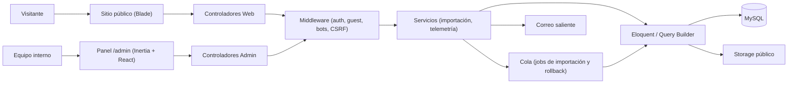
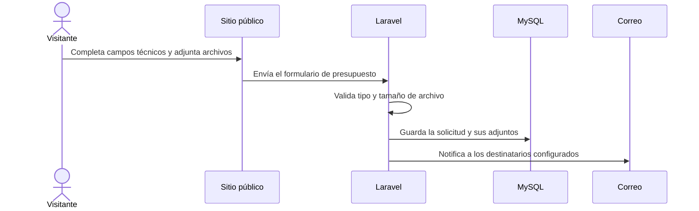
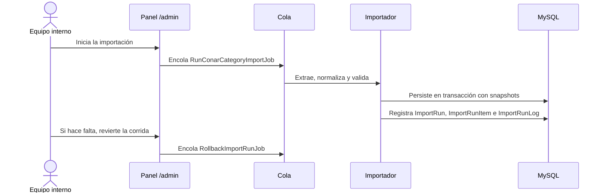
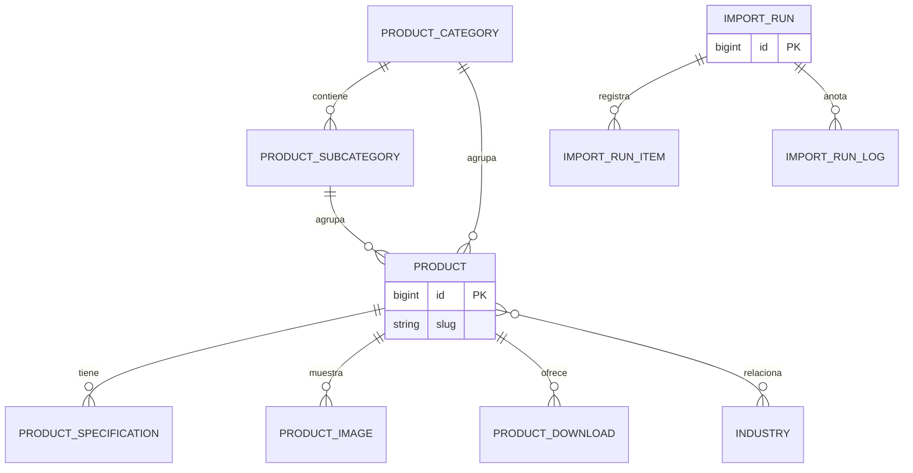

<div align="center">

<br/>

**Sitio corporativo con catálogo técnico, panel de contenido y solicitudes comerciales.**


</div>


## 📑 Contenido

[El problema](#-el-problema) · [La solución](#-la-solución) · [Funcionalidades](#-funcionalidades) · [Arquitectura](#-arquitectura) · [Flujos de trabajo](#-flujos-de-trabajo) · [Modelo de datos](#-modelo-de-datos) · [Criterios y decisiones](#-criterios-y-decisiones) · [Stack](#-stack) · [Estructura](#-estructura-del-repo) · [Puesta en marcha](#-puesta-en-marcha) · [Pruebas y calidad](#-pruebas-y-calidad) · [Despliegue](#-despliegue) · [Estado y pendientes](#-estado-y-pendientes) · [Licencia y autoría](#-licencia-y-autoría)


## 🧩 El problema

Un catálogo técnico con muchas familias de productos, especificaciones, descargas y industrias relacionadas no entra bien en una página estática. Cada cambio de producto, de ficha técnica o de novedad requería intervención de desarrollo, y las consultas comerciales (contacto, suscripción y presupuesto con datos técnicos y adjuntos) llegaban sin un registro ordenado.

Además, el catálogo necesitaba estar disponible en español, portugués e inglés sin duplicar páginas a mano.

## 💡 La solución

**CONAR** es una aplicación Laravel con dos caras:

- **Sitio público**, renderizado con Blade: catálogo por categorías, subcategorías y productos, con especificaciones, imágenes, descargas e industrias; páginas corporativas, novedades y formularios comerciales. El contenido se muestra en el idioma elegido por el visitante.
- **Panel `/admin`**, con Inertia y React, para el equipo interno: catálogo, CMS, descargas, novedades, clientes, contactos, newsletter, usuarios y módulos de recursos humanos.

El panel exige sesión autenticada. Las solicitudes llegan a una bandeja y disparan notificaciones por correo a los destinatarios configurados.


## ✨ Funcionalidades

**Sitio público** (rol: visitante)
- Catálogo de productos, categorías, subcategorías, especificaciones, imágenes, descargas e industrias relacionadas.
- Páginas corporativas, secciones CMS, sliders, novedades y metadatos SEO.
- Contacto, suscripción a newsletter y solicitud de presupuesto con campos técnicos dinámicos y archivos adjuntos validados.
- Idioma por sesión o cookie: español, portugués e inglés.

**Panel `/admin`** (rol: equipo interno autenticado)
- Gestión de catálogo, CMS, descargas, novedades, clientes, contactos, newsletter y usuarios.
- Módulos de recursos humanos.
- Importación de categorías desde el sitio de origen del catálogo (proveedor CONAR): extracción, normalización, descarga opcional de activos, persistencia transaccional, trazabilidad de la corrida y reversión.

**Analítica propia**
- Eventos de página, sesiones y agregados horarios, sin depender de una plataforma externa.
- Detección heurística de bots: los benignos no cuentan como visitas; los patrones maliciosos se bloquean.


## 🏗️ Arquitectura

Monolito Laravel. Rutas, controladores, modelos Eloquent, servicios de importación, jobs y comandos Artisan conviven en un mismo repositorio. El sitio público se renderiza con Blade y el panel intercambia props con Inertia y componentes React.

El importador está separado en crawler, parser, normalizador, DTOs, orquestador e importador: los datos externos se transforman antes de tocar los modelos locales. Detalle en [docs/scraping-import-conar.md](docs/scraping-import-conar.md).






## 🔄 Flujos de trabajo

**Solicitud de presupuesto**



**Importación de categorías**




## 🗃️ Modelo de datos

Persistencia con Eloquent sobre MySQL, con 48 migraciones versionadas.



Las importaciones se auditan con `ImportRun`, `ImportRunItem` e `ImportRunLog`. El CMS usa páginas, secciones, imágenes de sección, sliders, ajustes, metadatos SEO y publicaciones. Los formularios persisten contactos, suscriptores y solicitudes de presupuesto. La analítica guarda eventos, sesiones, bloqueos de bots y resúmenes horarios.


## 🧭 Criterios y decisiones

- **Un importador en etapas.** El crawler no toca la base: solo el importador escribe, dentro de transacciones y con snapshots que permiten revertir una corrida completa.
- **Contenido traducible como JSON.** Los textos se resuelven por idioma en una capa de soporte para tres locales, sin duplicar páginas.
- **IP nunca en texto plano.** La telemetría guarda el hash SHA-256 de la IP.
- **Telemetría acotada.** El endpoint valida UUID y tipo de evento, y está limitado a 120 solicitudes por minuto.

| Decisión | Por qué |
| --- | --- |
| Monolito Laravel con Blade y Inertia/React | Un solo backend y una sola base; el sitio público necesita render en servidor y el panel necesita interacción. |
| Analítica propia en vez de una plataforma externa | Evita depender de un tercero y mantiene los datos de navegación dentro del sistema. |
| Importación con cola, rollback y trazabilidad | Permite cargar el catálogo sin dejarlo a medias y revertir una corrida sin afectar el resto. |


## 🧱 Stack

| Capa | Tecnología | Versión |
| --- | --- | --- |
| Lenguaje | PHP | ^8.2 |
| Backend | Laravel framework | ^12.0 (lock 12.53.0) |
| Integración panel | inertiajs/inertia-laravel | 2.0.21 |
| API y sesiones | Laravel Sanctum | 4.3.1 |
| Frontend | React | 18.3.1 |
| Frontend | @inertiajs/react | 2.3.17 |
| Estilos | Tailwind CSS | 4.2.1 |
| Build | Vite | 7.3.6 |
| Pruebas | PHPUnit | ^11.5 |
| Base de datos | MySQL | configurada en `.env.example` |


## 🗂️ Estructura del repo

```text
app/Http/Controllers/Web/     sitio público
app/Http/Controllers/Admin/   panel /admin
app/Http/Controllers/         telemetría y perfil
app/Services/Importers/       importación de catálogo
app/Services/Scraping/        crawler y parser del origen
app/Jobs/                     importación y rollback en cola
routes/web.php, admin.php     rutas públicas y del panel
routes/api.php                POST /api/telemetry
database/migrations/          esquema relacional
resources/views/              Blade público
resources/js/                 panel React e Inertia
docs/                         documentación del importador
tests/                        pruebas unitarias y de funcionalidad
```


## 🚀 Puesta en marcha

Requisitos: PHP 8.2+, Composer, Node.js, npm y MySQL.

```bash
cp .env.example .env             # definir base, correo y geolocalización localmente
composer install
npm ci
php artisan key:generate
php artisan migrate
php artisan storage:link
composer dev                     # servidor, cola, logs y Vite en paralelo
```

Alternativa: `php artisan serve` y `npm run dev` en terminales separadas.

Variables relevantes (por nombre, sin valores): conexión de base de datos, `MAIL_*`, `QUEUE_CONNECTION`, y las de geolocalización (IPinfo o IPStack). Los valores reales no se versionan.


## 🧪 Pruebas y calidad

- Pruebas unitarias del parser de categorías y pruebas de funcionalidad de autenticación, perfil y página principal.
- Formato con Laravel Pint.

```bash
php artisan test
vendor/bin/pint --test
npm run build
```

La última revisión registrada en la versión anterior de este README fue de 29 pruebas y 69 aserciones aprobadas; no se volvió a ejecutar para este cambio. No hay pruebas E2E, de carga, análisis estático ni pipeline CI versionados.


## 🚢 Despliegue

No documentado en el repositorio. No hay Dockerfile, Docker Compose, configuración de servidor, backups ni pipeline de CI/CD versionados. El scheduler agrega la analítica cada quince minutos y necesita un worker de cola en el entorno real; ambos se configuran fuera de este código.


## 📌 Estado y pendientes

- **Estado:** aplicación funcional con catálogo, CMS, formularios, importación, analítica y panel.
- **Último commit:** 2026-05-14, `VERSION 1.0.4`, en el historial local.
- **Producción:** no verificado.
- **Pendientes:** definir despliegue, worker de cola y copias de seguridad; ampliar las pruebas más allá de autenticación y página principal.


## 📄 Licencia y autoría

Desarrollado por el **Ing. Santiago Abasto**.


Repositorio sin archivo de licencia. El código y el contenido son propiedad del cliente, salvo que se acuerde otra cosa.
